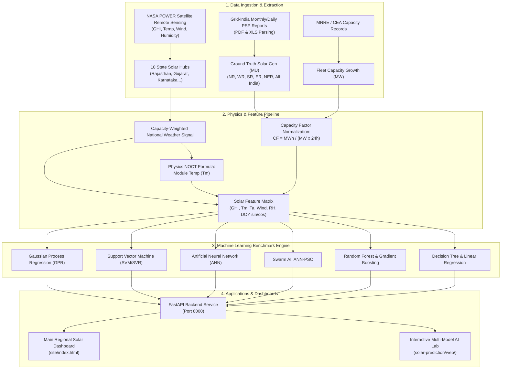

# HeliosAI: All-India & Regional Solar Power Generation Forecasting & Analytics Platform

[](https://www.python.org/)
[](https://fastapi.tiangolo.com/)
[](https://scikit-learn.org/)
[](https://power.larc.nasa.gov/)
[](https://grid-india.in/)

---

## 1. Executive Summary & Problem Statement

Solar energy in India is expanding at an unprecedented rate, with national utility-scale capacity growing over **40% between 2024 and 2026** (surpassing 115,000 MW). However, solar power is inherently intermittent—heavily influenced by cloud cover, atmospheric water vapor, seasonal monsoon patterns, and high-temperature thermal efficiency losses. 

Because electricity grids must maintain an instantaneous balance between power generation and electricity demand at a precise frequency of **50.00 Hz**, unpredictable solar fluctuations present critical risks:
- Sudden unpredicted solar drops can trigger regional grid instability and blackouts.
- Power distribution companies (DISCOMs) risk severe financial penalties under **Central Electricity Regulatory Commission (CERC) Deviation Settlement Mechanism (DSM)** regulations if their scheduled generation deviates from actual output by more than **10%–15%**.

**HeliosAI** is an end-to-end Machine Learning and Physics-Informed forecasting platform that extracts real operational power data from **Grid-India (POSOCO) Power Supply Position (PSP)** reports, ingests daily satellite weather observations from **NASA POWER**, normalizes generation by national fleet growth, and delivers day-ahead and monthly solar forecasts across all five Indian electrical regions (NR, WR, SR, ER, NER) and All-India.

---

## 2. End-to-End System Architecture



---

## 3. Data Sources

| Stream | Provider | Frequency | Features Extracted |
| :--- | :--- | :--- | :--- |
| **Grid Generation** | **Grid Controller of India (Grid-India / POSOCO)** | Daily & Monthly | Solar generation (MU), Wind generation (MU), Hydro generation (MU), Evening peak demand (MW), Energy met (MU). |
| **Meteorology** | **NASA Langley Research Center (NASA POWER)** | Daily Satellite | Global Horizontal Irradiance (GHI, $kWh/m^2/day$), Direct Normal Irradiance (DNI), Ambient Temperature at 2m ($T_a$), Wind Speed at 10m ($W_s$), Relative Humidity ($RH$). |
| **Fleet Capacity** | **Ministry of New and Renewable Energy (MNRE / CEA)** | Monthly | Cumulative utility-scale installed solar capacity (MW) nationally and region-wise. |

---

## 4. Scientific & Mathematical Methods

### 4.1. Capacity-Weighted National Weather Aggregation
India's solar capacity is geographically concentrated in high-insolation western and southern states. A simple arithmetic mean across the country's landmass would misrepresent actual generation conditions. HeliosAI aggregates daily weather across **10 representative solar hub coordinates**, weighted by each state's share of national installed capacity:

$$\text{Weather}_{\text{National}, t} = \sum_{i=1}^{10} w_i \times \text{Weather}_{i, t}$$

- **Rajasthan** (Bhadla / Thar Desert belt): **22% weight**
- **Gujarat** (Charanka / Khavda belt): **14% weight**
- **Karnataka** (Pavagada solar park): **12% weight**
- **Andhra Pradesh** (Kurnool solar park): **9% weight**
- **Tamil Nadu** (Kamuthi solar facility): **8% weight**
- **Telangana** (Hyderabad / Deccan belt): **7% weight**
- Additional hubs: Madhya Pradesh (Rewa), Maharashtra, Uttar Pradesh, and Punjab.

### 4.2. Physics-Informed Module Temperature Modeling (NOCT)
Silicon photovoltaic cells experience thermal degradation—their bandgap efficiency decreases by approximately **0.4% per °C rise above 25°C**. To capture this, HeliosAI models cell temperature ($T_m$) using the **Nominal Operating Cell Temperature (NOCT)** thermodynamic equation:

$$T_m = T_a + \frac{G}{800} \times (\text{NOCT} - 20)$$

Where:
- $T_m$ = Silicon PV cell module temperature (°C)
- $T_a$ = Ambient air temperature at 2 meters (°C)
- $G$ = Solar irradiance flux ($W/m^2$)
- $\text{NOCT}$ = $45^\circ\text{C}$ (Standard nominal operating cell temperature)

### 4.3. Fleet Expansion & Capacity Factor Normalization
Between April 2024 and late 2026, India's solar capacity expanded by nearly **40%**. Directly predicting raw generation in Million Units (MU) would result in massive distribution drift because identical sunny days in 2024 and 2026 yield vastly different energy outputs.

HeliosAI overcomes this by training models on the dimensionless **Capacity Factor ($CF$)**:

$$CF = \frac{\text{Daily Solar Generation (MWh)}}{\text{Installed Capacity (MW)} \times 24\text{ hours}}$$

During inference, predicted generation in MU is recovered by scaling back with the projected fleet capacity:

$$\widehat{\text{Generation}}_{\text{MU}} = \widehat{CF} \times \text{Installed Capacity (MW)} \times 24 \times 10^{-3}$$

### 4.4. Cyclical Solar Geometry Encodings
Earth's orbital declination causes annual sun angles to shift continuously. Day-of-year (DOY) is encoded into continuous cyclical trigonometric coordinates to prevent boundary discontinuities between December 31 and January 1:

$$\text{DOY}_{\sin} = \sin\left(\frac{2\pi \cdot \text{DOY}}{365.25}\right), \quad \text{DOY}_{\cos} = \cos\left(\frac{2\pi \cdot \text{DOY}}{365.25}\right)$$

---

## 5. Machine Learning & AI Model Catalog

HeliosAI benchmarks 8 distinct model architectures across both daily and monthly forecasting horizons:

1. **Gaussian Process Regression (GPR)** (`solar-prediction/src/models/gpr_model.py`):
   - Non-parametric Bayesian model with Radial Basis Function (RBF) kernels. Computes full predictive distributions with confidence intervals.
2. **Support Vector Machine (SVM / SVR)** (`solar-prediction/src/models/svm_model.py`):
   - Non-linear Support Vector Regression utilizing RBF kernel projection to map weather features into high-dimensional support vector margins.
3. **Artificial Neural Network (ANN / Multi-Layer Perceptron)** (`solar-prediction/src/models/ann.py`):
   - Fully connected deep neural network with hidden layers, ReLU activation, weight decay regularization, and Adam optimization.
4. **ANN with Particle Swarm Optimization (ANN-PSO)** (`solar-prediction/src/models/ann_pso.py`):
   - Swarm intelligence metaheuristic algorithm where artificial particles explore the hyperparameter and weight space to find global error minima.
5. **Random Forest Regressor** (`backend/app/ai/training.py`):
   - Multi-tree bagging ensemble with bootstrap aggregation and randomized feature splits.
6. **Histogram-based Gradient Boosting Regressor** (`backend/app/ai/training.py`):
   - Tree boosting ensemble optimized for continuous feature binned splits.
7. **Decision Tree Regressor** (`solar-prediction/src/models/decision_tree.py`):
   - Single-tree rule-based partitioning baseline.
8. **Regularized Linear Regression** (`solar-prediction/src/models/linear.py`):
   - Ordinary Least Squares baseline with ridge regularization.

---

## 6. Experimental Benchmark Results (2026 Test Set)

Models were trained on **2024–2025 daily data (640 days)** and rigorously evaluated on an unseen **2026 chronological holdout dataset (124 days)**:

| Rank | Model Architecture | Physics Module Temp | RMSE (MU) | MAE (MU) | $R^2$ Score | MAPE (%) | Accuracy (%) |
| :---: | :--- | :---: | :---: | :---: | :---: | :---: | :---: |
| 🥇 | **Gaussian Process Regression (GPR)** | **Without NOCT** | **32.7** | **26.7** | **0.598** | **4.47%** | **95.53%** |
| 🥈 | **Gaussian Process Regression (GPR)** | **With NOCT** | **32.7** | **26.9** | **0.597** | **4.50%** | **95.50%** |
| 🥉 | **Support Vector Machine (SVM)** | Without NOCT | 35.4 | 28.7 | 0.530 | 4.77% | 95.23% |
| 4 | **Support Vector Machine (SVM)** | With NOCT | 36.0 | 29.0 | 0.514 | 4.81% | 95.19% |
| 5 | **ANN with Particle Swarm Optimization (PSO)** | Without NOCT | 36.5 | 29.4 | 0.498 | 4.92% | 95.08% |
| 6 | **Artificial Neural Network (ANN / MLP)** | With NOCT | 43.1 | 34.0 | 0.303 | 5.70% | 94.30% |
| 7 | **Linear Regression Baseline** | With NOCT | 42.1 | 35.5 | 0.335 | 5.98% | 94.02% |
| 8 | **Decision Tree Regressor** | Without NOCT | 44.4 | 36.8 | 0.258 | 6.18% | 93.82% |

> **Key Finding**: Gaussian Process Regression (GPR) achieved the lowest error (**4.47% MAPE** and **32.7 MU RMSE**), demonstrating exceptional resistance to overfitting on noisy weather fluctuations compared to single decision trees.

---

## 7. Real-World Use Cases: What Happens After Prediction?

```
                         [ AI Forecast Output ]
                                   │
         ┌─────────────────────────┼─────────────────────────┐
         ▼                         ▼                         ▼
[ Grid Stability ]        [ Market Bidding ]        [ Storage Dispatch ]
  • Ramp down coal          • Day-Ahead Market        • Charge BESS at solar peak
    during solar peak.        bidding on IEX.           (11:00 - 14:00).
  • Prepare spinning        • Avoid CERC DSM          • Discharge during evening
    reserves for evening.     penalties (>10% dev).     peak (19:00 - 22:00).
```

### 1. Power System Operations (NLDC / RLDCs / SLDCs)
- **Real-Time Frequency Control**: Balancing India's national grid around 50.00 Hz by scheduling conventional thermal and hydro ramping prior to solar transitions.
- **Spinning Reserve Allocation**: Pre-allocating flexible gas or hydro generators when regional solar irradiance drops are forecast.

### 2. Commercial Trading & Penalty Avoidance
- **CERC Deviation Settlement Mechanism (DSM)**: Electricity rules levy escalating financial penalties on renewable generators whose actual output deviates beyond ±10% to ±15% of their Day-Ahead schedule. The AI's 4.5% error margin ensures compliance well within safe limits.
- **Power Exchange Trading (IEX / PXIL / HPX)**: Optimizing Day-Ahead Market (DAM) and Real-Time Market (RTM) purchase and sale commitments.

### 3. Battery Energy Storage Systems (BESS) & Pumped Hydro
- **Time-of-Use Arbitrage**: Directing grid-scale battery systems to absorb excess midday solar surplus and dispatching stored energy into the high-value evening peak (19:00–22:00) when solar output reaches zero.

### 4. Plant Operations & Maintenance (O&M)
- **Condition-Based Scheduling**: Scheduling solar panel string washing, inverter preventative maintenance, and transformer overhauls during forecast low-irradiance windows (monsoon) rather than peak solar harvest periods.

---

## 8. Technology Stack

- **Backend Service**: FastAPI, Uvicorn, SQLite3, Pydantic, Joblib
- **Machine Learning Core**: Scikit-Learn, NumPy, Pandas, SciPy
- **Document & Data Parsing**: PDFPlumber, XLRD, Regular Expressions
- **Frontend Applications**: Vite, Vanilla Modern JavaScript (ES Modules), Chart.js, CSS3 Custom Properties
- **Data APIs**: NASA POWER REST API (Renewable Energy Community)

---

## 9. Quickstart Guide

### 1. Activate Environment & Start Backend Server
```zsh
# Free port 8000 if occupied
kill -9 $(lsof -ti :8000) 2>/dev/null

# Start the unified FastAPI backend
.venv/bin/python -m uvicorn backend.app.main:app --reload --port 8000
```

### 2. Access the Applications
- **Main Production Dashboard**: Open [`http://localhost:8000`](http://localhost:8000)
- **Multi-Model AI Prediction Lab**: Open [`http://localhost:8000/lab`](http://localhost:8000/lab)

### 3. Re-train Models & Run Benchmarks
```zsh
# Run the 6-model ML benchmark suite
solar-prediction/.venv/bin/python solar-prediction/src/run.py

# Re-extract and scale 2026 actual generation
.venv/bin/python scripts/import_actuals_from_daily.py --apply
```
